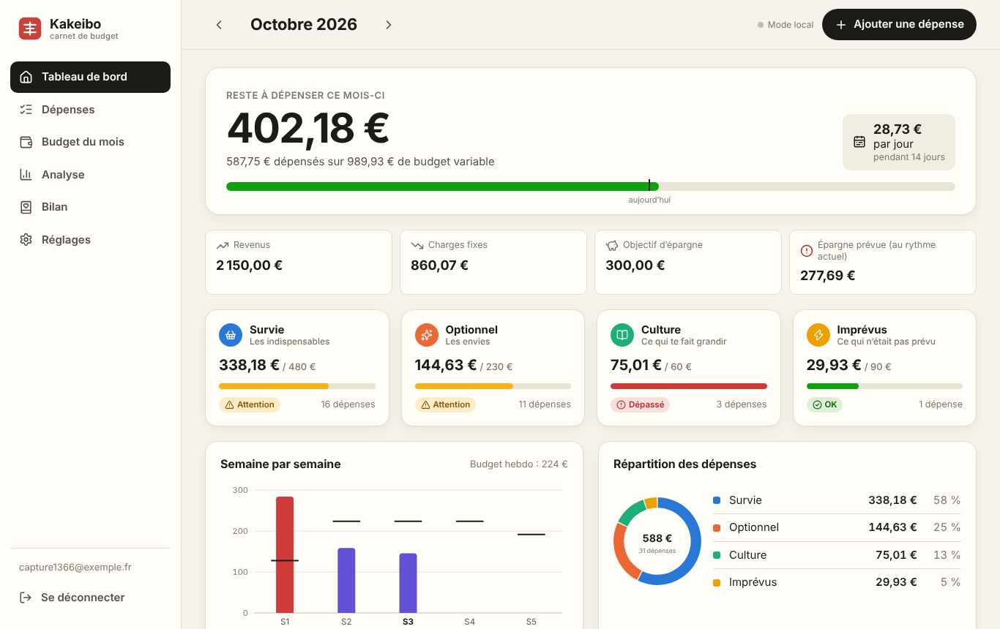
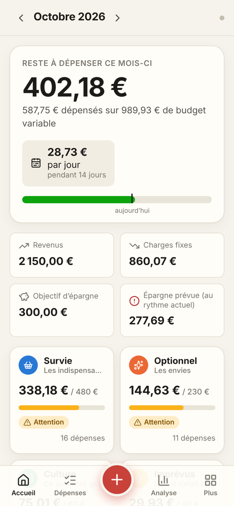
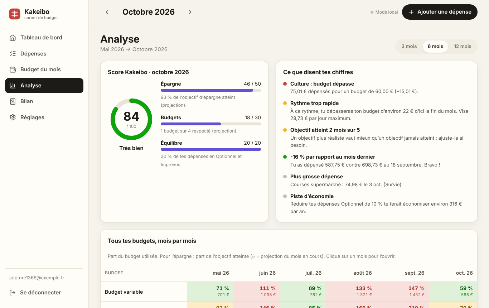

# Kakeibo — carnet de budget synchronisé

Application de suivi de budget inspirée de la méthode japonaise **Kakeibo** (家計簿, « livre de comptes du foyer »).
Elle fonctionne sur **ordinateur** (version PC avec menu latéral et tableaux) et sur **téléphone** (version mobile avec onglets et bouton +), avec un **compte par utilisateur** : ce que tu saisis sur ton téléphone apparaît en temps réel sur ton PC.

👉 **Pour publier l'appli gratuitement et la rendre téléchargeable par tout le monde : [TUTORIEL.md](TUTORIEL.md).**



<p align="center"></p>

## Fonctionnalités

- **Comptes utilisateurs** : inscription, connexion, changement de mot de passe, mot de passe oublié, suppression du compte. Chaque utilisateur ne voit que ses données (règles de sécurité de la base).
- **Synchronisation en temps réel** entre tous tes appareils, avec affichage hors ligne de la dernière version.
- **Budget du mois** (la base du Kakeibo) : revenus, charges fixes, objectif d'épargne → ce qu'il te reste à dépenser. Reprise du mois précédent en un clic, budgets par catégorie avec répartition suggérée.
- **Dépenses** rangées dans les 4 catégories Kakeibo : *Survie*, *Optionnel*, *Culture*, *Imprévus*. Saisie rapide (libellés fréquents, « Ajouter et continuer », touche **N** sur PC).
- **Tableau de bord** : reste à dépenser, montant par jour jusqu'à la fin du mois, jauges par catégorie, semaine par semaine, répartition.
- **Analyse de tous tes budgets** sur 3, 6 ou 12 mois : score Kakeibo sur 100, alertes et conseils automatiques, tableau des budgets mois par mois (OK / attention / dépassé), dépenses par catégorie, épargne réelle vs objectif, jours les plus dépensiers, moyennes, plus grosses dépenses, récapitulatif.
- **Bilan mensuel** avec les 4 questions du Kakeibo et tes notes (fierté, amélioration, engagement).
- Export **CSV** (Excel), sauvegarde / restauration **JSON**, données d'exemple, thème clair / sombre, plusieurs devises.
- **Installable** : appli web (PWA) sur Android, iPhone, Windows, Mac, Linux — et fichiers `.exe`, `.dmg`, `.AppImage`, `.apk` générés automatiquement par GitHub.



## Lancer sur ton ordinateur

Prérequis : [Node.js](https://nodejs.org) 22 ou plus.

```bash
npm install
npm run dev          # http://localhost:5173
```

Sans configuration, l'appli démarre en **mode local** (comptes et données dans le navigateur, sans synchronisation) — idéal pour tester. Pour utiliser ta base Supabase, copie `.env.example` en `.env.local` et renseigne tes deux clés.

| Commande | Rôle |
| --- | --- |
| `npm run dev` | Serveur de développement |
| `npm run build` | Site web installable (dossier `dist/`) |
| `npm run build:app` | Version pour les applis natives (chemins relatifs, sans service worker) |
| `npm run typecheck` | Vérification TypeScript |

## Organisation du projet

```
supabase/schema.sql        Base de données : tables, sécurité par utilisateur, temps réel
src/lib/kakeibo.ts         Calculs du mois (budget variable, semaines, projection, score)
src/lib/insights.ts        Analyse automatique et conseils
src/lib/cloud.ts           Connexion à Supabase (comptes, données, temps réel)
src/lib/local.ts           Mode local sans serveur
src/pages/                 Écrans : tableau de bord, dépenses, budget, analyse, bilan, réglages
src/components/charts.tsx  Graphiques (SVG, sans dépendance)
desktop/                   Application de bureau (Electron)
capacitor.config.json      Application Android (Capacitor)
.github/workflows/         Mise en ligne automatique + fabrication des applis
```

Technique : React 19, TypeScript, Vite, Supabase (Auth, Postgres avec Row Level Security, Realtime), vite-plugin-pwa, Electron, Capacitor. Les couleurs des catégories ont été vérifiées pour rester distinguables par les personnes daltoniennes, et chaque couleur est toujours accompagnée d'un nom ou d'une icône.

## Licence

MIT — libre d'utilisation, de modification et de redistribution.
